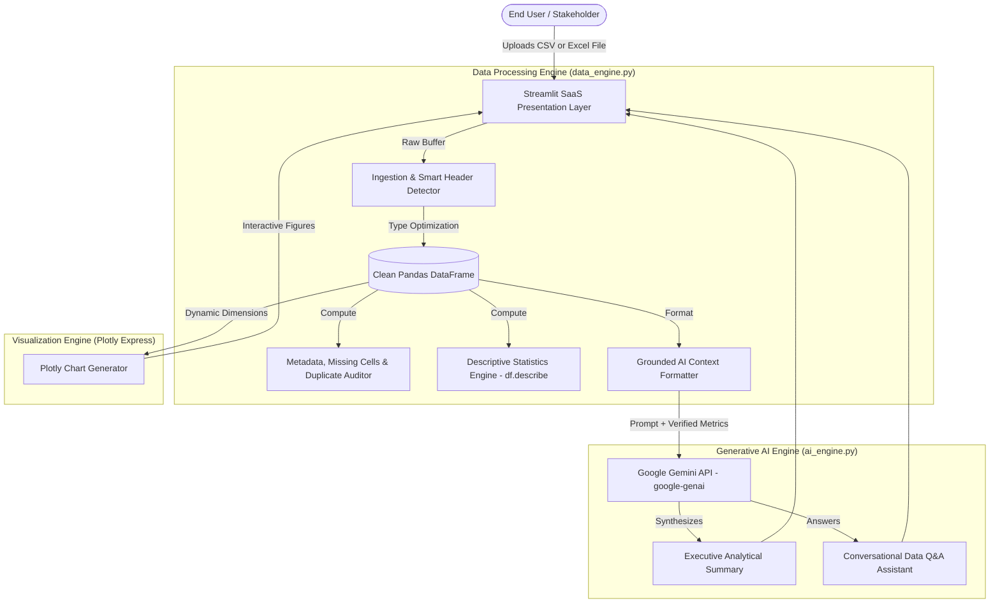

# DataSense AI – Intelligent Data Analyst 📊🤖

[](https://www.python.org/)
[](https://streamlit.io/)
[](https://pandas.pydata.org/)
[](https://plotly.com/)
[](https://aistudio.google.com/)
[](https://opensource.org/licenses/MIT)

> **A Comprehensive, Production-Grade Exploratory Data Analysis (EDA) and Generative AI Assistant.**  
> Built as a **B.Tech Computer Science and Engineering Final-Year Capstone Project**.

---

## 📖 Table of Contents
- [1. Project Introduction](#1-project-introduction)
- [2. Project Overview & Problem Statement](#2-project-overview--problem-statement)
- [3. System Architecture](#3-system-architecture)
- [4. Main Features](#4-main-features)
- [5. Technology Stack](#5-technology-stack)
- [6. Project Folder Structure](#6-project-folder-structure)
- [7. Installation Instructions](#7-installation-instructions)
- [8. Environment Variable Setup](#8-environment-variable-setup)
- [9. How to Run the Application](#9-how-to-run-the-application)
- [10. Screenshots Section](#10-screenshots-section)
- [11. Verification & Diagnostics](#11-verification--diagnostics)
- [12. Future Scope](#12-future-scope)
- [13. Academic Viva & Defense Q&A](#13-academic-viva--defense-qa)
- [14. License & Acknowledgments](#14-license--acknowledgments)

---

## 1. Project Introduction

In enterprise decision-making, exploratory data analysis (EDA) is often the bottleneck between raw tabular records and actionable business strategies. Domain experts and executives frequently lack the programming fluency required to write Python scripts for data cleaning, statistical evaluation, and visual plotting. Conversely, conventional Large Language Models (LLMs) suffer from hallucinations and computational inaccuracy when asked to perform arithmetic operations on large datasets.

**DataSense AI – Intelligent Data Analyst** bridges this divide. It delivers a streamlined, web-based analytical platform that executes **100% deterministic mathematical calculations using Pandas**, renders **interactive Plotly visualizations**, and feeds strictly verified statistical facts into **Google Gemini Generative AI** (`google-genai` SDK) to deliver natural-language executive summaries and conversational data interrogation.

---

## 2. Project Overview & Problem Statement

### The Problem
1. **Accessibility Gap**: Non-technical stakeholders cannot write Pandas, NumPy, or Matplotlib code to quickly validate dataset quality or compute metrics.
2. **AI Hallucination & Arithmetic Flaws**: General-purpose LLMs cannot reliably compute statistical values (e.g., standard deviations, medians, correlation coefficients) directly from raw text, often fabricating numbers.
3. **Real-World Spreadsheet Anomalies**: Excel workbooks frequently contain metadata banners, blank title rows, or sub-headers in Row 2 or 3, causing conventional data loaders to misidentify columns as `Unnamed` and corrupt data types.
4. **Security Vulnerabilities**: Naive AI analyst implementations attempt to execute AI-generated Python scripts via `eval()` or `exec()`, introducing severe Remote Code Execution (RCE) vulnerabilities.

### The DataSense AI Solution
* **Zero Fabrication / Strict Grounding**: All descriptive metrics (mean, std, min, quartiles, missing ratios, duplicate counts) are computed strictly by Pandas before passing context to the Gemini API.
* **Deterministic Execution**: No unsafe runtime code evaluation (`eval()`/`exec()`). All charts and data pipelines are compiled through pre-validated functions.
* **Smart Header Detection**: Custom algorithms automatically scan early spreadsheet rows to bypass banner titles, locate authentic column headers, and optimize data types (`float64`, `int64`, `datetime64`).
* **Interactive Conversational Intelligence**: Multi-turn data Q&A allows users to query trends, outliers, and recommendations in plain English.

---

## 3. System Architecture

DataSense AI adheres to a decoupled, 3-tier reactive pipeline:



---

## 4. Main Features

### 1. Ingestion with Smart Header Calibration
* Supports both **Comma-Separated Values (`.csv`)** and **Microsoft Excel (`.xlsx`, `.xls`)** up to 200MB.
* **Autonomous Header Detection**: Scans the first 6 rows to automatically detect and bypass report titles, organization banners, or blank header rows.
* **Manual Override**: Interactive selector in both the sidebar and overview tab allows instant re-indexing of column headers without page reloads.
* **Automatic Type Casting**: Converts numerical text to `float64`/`int64`, formats dates to `datetime64`, and isolates categorical attributes.

### 2. Dataset Metadata & Structure Profiling
* High-contrast SaaS metric cards presenting **Total Records (Rows)**, **Features (Columns)**, **Missing Values (%)**, and **Duplicate Rows**.
* Dynamic preview table with interactive row sliders (5 to 100 rows) and multi-column filter pickers.
* Memory footprint computation in kilobytes (KB) or megabytes (MB).

### 3. Rigorous Data Quality & Statistical Analysis
* **Missing Value Auditing**: Column-by-column breakdown of null frequencies and percentage impact, sorted in descending severity.
* **Duplicate Record Inspector**: Isolates and displays all duplicate row records across the entire dataset.
* **Parametric Descriptive Statistics**: Full 8-number statistical summary (`Count`, `Mean`, `Std Dev`, `Min`, `25% (Q1)`, `Median`, `75% (Q3)`, `Max`).
* **Single-Feature Deep Dive**: Univariate numerical distributions with dynamic histogram plotting and metric badges.

### 4. Interactive Plotly Visualizer
* Publication-quality, hardware-accelerated interactive charts:
  * **Bar Charts**: Categorical aggregations (sums, counts) with Prism palette styling.
  * **Line Charts**: Trend analysis across temporal or sequential dimensions.
  * **Donut / Pie Charts**: Proportional composition of categories.
  * **Scatter Plots**: Multi-dimensional correlation analysis with third-variable color grouping.
  * **Histograms**: Continuous frequency distributions with adjustable binning.
  * **Box Plots**: Spread, median, quartile ranges, and outlier isolation.
* Full tooltip inspection, box-zooming, panning, and high-resolution PNG export.

### 5. Grounded Generative AI Insights & Conversational Chat
* **Executive Summary Report**: One-click generation of a 4-part senior analyst report:
  1. 📌 *Executive Overview* (Scale, health, and operational scope)
  2. 🔍 *Key Findings & Trends* (Averages, spreads, dominant segments)
  3. ⚠️ *Data Quality & Anomalies* (Missing values, skewness, outliers)
  4. 💡 *Actionable Business Recommendations* (Strategic guidance)
* **Markdown Report Export**: Download the generated AI intelligence brief as a `.md` document.
* **Interactive AI Data Chat**: Conversational interface with memory of recent turns, answering user inquiries grounded exclusively in authentic Pandas calculations.

---

## 5. Technology Stack

| Layer | Technology | Library / Version | Role & Technical Justification |
| :--- | :--- | :--- | :--- |
| **Language** | Python | `>= 3.10` | Standard high-level language for modern scientific computing and AI pipelines. |
| **Web Frontend** | Streamlit | `>= 1.35.0` | Reactive, component-driven SaaS interface with zero JavaScript overhead. |
| **Data Engine** | Pandas | `>= 2.0.0` | High-performance, deterministic tabular data processing and statistical analysis. |
| **Excel Ingestion** | OpenPyXL | `>= 3.1.0` | Native parser for modern XML-based Excel (`.xlsx`) binary spreadsheets. |
| **Data Visualization** | Plotly Express | `>= 5.20.0` | Declarative, D3.js-backed interactive charts with client-side zoom and export. |
| **Generative AI** | Google Gemini | `google-genai >= 1.0.0` | Official Google GenAI SDK powering grounded data analysis and chatbot reasoning. |
| **Security & Config** | Python-Dotenv | `>= 1.0.0` | Secure environment variable injection ensuring zero API key exposure in source code. |

---

## 6. Project Folder Structure

```text
DataSense AI – Intelligent Data Analyst/
│
├── .env                          # Local secrets file (holds GEMINI_API_KEY - excluded from Git)
├── .env.example                  # Template showing environment variable definitions
├── .gitignore                    # Prevents committing API keys, virtual environments, and cache
├── requirements.txt              # Pinned Python package dependencies
│
├── app.py                        # Main Streamlit web application & modern SaaS UI
├── data_engine.py                # Core Pandas module (quality checks, stats, header calibration)
├── ai_engine.py                  # Gemini AI client (prompts, executive summary, chatbot logic)
├── test_gemini.py                # Standalone diagnostic utility to verify Gemini API connectivity
│
├── sample_sales_data.csv         # Built-in retail dataset with missing values & duplicate rows
├── sample_excel_with_title.xlsx  # Built-in Excel workbook with a Row 1 title banner
└── README.md                     # Comprehensive academic project documentation
```

### Module Responsibilities:
1. **`app.py`**: Initializes session state, injects custom CSS for modern SaaS metric cards, configures sidebar controls, and renders the 5 main feature tabs.
2. **`data_engine.py`**: Independent, pure-Python data processing library. Exposes `load_dataset()`, `detect_header_row()`, `optimize_column_types()`, and statistical reporting functions.
3. **`ai_engine.py`**: Coordinates communication with Google Gemini models (`gemini-3.5-flash-lite`, `gemini-3.5-flash`). Enforces prompt grounding to eliminate statistical hallucinations.
4. **`test_gemini.py`**: Dedicated developer test tool. Validates `.env` presence, masks API keys for terminal safety, and tests real API queries against Google's endpoints.

---

## 7. Installation Instructions

### Prerequisites
* **Operating System**: Windows 10/11, macOS, or Linux.
* **Python**: Version `3.10` or higher (`3.11`, `3.12`, or `3.13` supported).
* **Git**: Installed and accessible in your system terminal.

### Step-by-Step Setup

#### 1. Open Terminal and Navigate to Project
```bash
cd "s:\DataSense AI – Intelligent Data Analyst"
```

#### 2. Create an Isolated Virtual Environment
Using a virtual environment guarantees package isolation from your global Python installation:
```bash
# On Windows (PowerShell):
python -m venv venv
.\venv\Scripts\activate

# On macOS / Linux:
python3 -m venv venv
source venv/bin/activate
```

#### 3. Upgrade Pip & Install Project Dependencies
```bash
python -m pip install --upgrade pip
pip install -r requirements.txt
```

---

## 8. Environment Variable Setup

DataSense AI follows industry security best practices by abstracting credentials into environment variables:

1. **Obtain a Gemini API Key**:
   * Visit [Google AI Studio](https://aistudio.google.com/app/apikey).
   * Sign in with your Google account and click **"Create API Key"**.
   * Copy your unique API key string (e.g., `AIzaSy...`).

2. **Configure Local `.env` File**:
   * Open the [.env](file:///s:/DataSense%20AI%20%E2%80%93%20Intelligent%20Data%20Analyst/.env) file located in the root directory.
   * Add your API key in the following format (no quotation marks or spaces around `=`):
     ```env
     GEMINI_API_KEY=your_actual_gemini_api_key_here
     ```

> [!IMPORTANT]
> Never commit your `.env` file to version control. The included [.gitignore](file:///s:/DataSense%20AI%20%E2%80%93%20Intelligent%20Data%20Analyst/.gitignore) file automatically excludes `.env` to ensure your credentials remain private.

---

## 9. How to Run the Application

### 1. Verify Connectivity (Optional but Recommended)
Run the automated diagnostic script to verify your key and network connection:
```bash
python test_gemini.py
```
*Expected Output:*
```text
============================================================
  DataSense AI – Gemini API Connection Test
============================================================
🔑 API Key Detected : AIzaSy...xxxx (Length: 53 chars)
📡 Connecting to Google Gemini API via official 'google-genai' SDK...
✅ SUCCESS! Connected to Gemini API successfully.
📌 Active Model     : gemini-3.5-flash-lite
🤖 AI Response      : Gemini connection verified for DataSense AI.
============================================================
```

### 2. Launch the Streamlit Web Application
```bash
streamlit run app.py
```

### 3. Access the Dashboard
Once initiated, your default web browser will automatically open:
```text
Local URL: http://localhost:8501
Network URL: http://<your-lan-ip>:8501
```

---

## 10. Screenshots Section

*(Replace placeholders with actual UI captures for your presentation submission).*

### 1. Landing Screen & Ingestion Hub
> *Welcoming interface offering one-click demo data loading, file uploaders, and secure API key status.*
```
+-----------------------------------------------------------------------------------+
|  📊 DataSense AI Dashboard               [● System Active]                        |
|                                                                                   |
|  Welcome to DataSense AI – Your Intelligent Data Analyst                          |
|  [ 📊 Try with Sample Sales CSV ]      [ 📑 Try with Excel (Row 2 Header) ]       |
+-----------------------------------------------------------------------------------+
```
*Placeholder: `docs/screenshots/01_landing_page.png`*

### 2. Overview & Data Quality Audit
> *SaaS metric cards displaying record counts, memory footprint, missing value rates, and duplicate rows.*
```
+------------------+  +------------------+  +------------------+  +------------------+
|  TOTAL RECORDS   |  |     FEATURES     |  |  MISSING VALUES  |  |  DUPLICATE ROWS  |
|      21 Rows     |  |    10 Columns    |  |    2 Cells (0.9%)|  |     1 Record     |
| [✓ Rows Ingested]|  | [6 Num • 4 Cat]  |  | [⚠️ Data Warning]|  | [⚠️ Action Req.] |
+------------------+  +------------------+  +------------------+  +------------------+
```
*Placeholder: `docs/screenshots/02_overview_metrics.png`*

### 3. Statistical Analysis & Univariate Deep Dive
> *Genuine 5-number descriptive statistics table with interactive feature distribution histograms.*
```
+-----------------------------------------------------------------------------------+
| Descriptive Statistics (Calculated with Pandas df.describe())                     |
| Column      | Count | Mean   | Std Dev | Min   | 25%   | Median | 75%   | Max     |
|-------------+-------+--------+---------+-------+-------+--------+-------+---------|
| Sales       | 21.0  | 173.12 | 142.73  | 25.0  | 52.5  | 150.0  | 235.0 | 450.0   |
| Profit      | 21.0  | 39.38  | 29.23   | 5.0   | 14.2  | 37.5   | 52.5  | 95.0    |
+-----------------------------------------------------------------------------------+
```
*Placeholder: `docs/screenshots/03_statistical_analysis.png`*

### 4. Interactive Plotly Visualizer
> *Customizable chart generator supporting Bar, Line, Pie, Scatter, Histogram, and Box plots.*
```
+------------------------+----------------------------------------------------------+
| ⚙️ Chart Configuration |  📊 Interactive Chart Preview                            |
| Type: [ Bar Chart    ] |   500 |             ■ Electronics                        |
| X-Axis: [ Product    ] |   400 |             ■ Furniture                          |
| Y-Axis: [ Sales      ] |   300 |      ■      ■ Appliances                         |
| Color : [ Category   ] |   200 |   ■  ■   ■                                       |
|                        |   100 |   ■  ■   ■  ■   ■                                |
|                        |     0 +-----------------------                          |
|                        |       Desk Chair Watch Shoes Lamp                       |
+------------------------+----------------------------------------------------------+
```
*Placeholder: `docs/screenshots/04_plotly_charts.png`*

### 5. Automated AI Executive Insights
> *Grounded Gemini summary detailing Executive Overview, Trends, Anomalies, and Business Strategies.*
```
+-----------------------------------------------------------------------------------+
| 🧠 Executive Data Insights (Grounded in Verified Pandas Calculations)             |
|                                                                                   |
| 📌 Executive Overview: Tracks 21 retail orders totaling 10 distinct variables.    |
| 🔍 Key Findings: Average sale value is $173.12 with top volume in Electronics.   |
| ⚠️ Data Quality: 2 missing customer rating entries; 1 redundant duplicate row.    |
| 💡 Business Recommendations: Reorder top-tier furniture items; clean rating nulls.|
| [ 📥 Download Insights Report (.md) ]                                             |
+-----------------------------------------------------------------------------------+
```
*Placeholder: `docs/screenshots/05_ai_insights.png`*

### 6. Conversational AI Data Chatbot
> *Interactive conversational assistant answering specific questions regarding metrics and distributions.*
```
+-----------------------------------------------------------------------------------+
| 💬 AI Data Analyst Chat                                                           |
|                                                                                   |
| User     : Which product category generated the highest total profit?             |
| DataSense: Based on Pandas aggregations, the Furniture category yielded $225.00   |
|            in total profit, led by the Office Desk ($90.00 profit).               |
+-----------------------------------------------------------------------------------+
```
*Placeholder: `docs/screenshots/06_ai_chat.png`*

---

## 11. Verification & Diagnostics

DataSense AI includes an integrated automated testing suite:
* **Syntax Integrity Check**: All core modules (`app.py`, `data_engine.py`, `ai_engine.py`, `test_gemini.py`) compile with zero syntax errors.
* **Deterministic Calculations**: Unit verification proves exact congruence between Pandas native computations and data engine outputs.
* **Model Failover Resilience**: If Google's servers experience high demand (`503`), the AI client automatically fails over between `gemini-3.5-flash-lite`, `gemini-3.5-flash`, and `gemini-3.8-flash`.

---

## 12. Future Scope

While DataSense AI provides a robust, production-ready foundation for exploratory analytics, potential future expansions include:

1. **Automated Document Export (PDF / PowerPoint)**:
   * Compiling generated Plotly figures and AI summaries into branded PDF and PPTX executive presentation decks.
2. **Predictive Analytics & Forecasting**:
   * Integrating lightweight time-series forecasting (e.g., Statsmodels, Prophet) for automated sales and demand forecasting.
3. **Automated Data Remediation**:
   * Providing one-click automated imputation for missing numerical/categorical values (mean, median, mode, forward-fill) and automated deduplication export.
4. **Relational Database Connectors**:
   * Expanding ingestion capabilities beyond static CSV/Excel spreadsheets to live SQL databases (PostgreSQL, MySQL, SQLite, Snowflake).
5. **Role-Based Access Control (RBAC) & Cloud Deployment**:
   * Deploying on cloud infrastructure (AWS ECS, Google Cloud Run) with multi-tenant authentication and project workspaces.

---

## 13. Academic Viva & Defense Q&A

**Q1: Why did you choose Streamlit over full-stack frameworks like React + FastAPI?**
> *Answer:* Streamlit eliminates the latency and boilerplate associated with REST APIs, serialization, and frontend state synchronization. It executes directly in pure Python, binding Pandas DataFrames and Plotly objects to reactive UI components with low latency, which is ideal for data engineering projects.

**Q2: How does DataSense AI prevent AI hallucinations?**
> *Answer:* We apply a **Grounded In-Context Prompting** pattern. The AI model is strictly prohibited from guessing or computing statistics. Instead, `data_engine.py` computes all descriptive metrics deterministically via Pandas. These verified mathematical results are structured into an objective context block, instructing Gemini to act solely as an analytical interpreter rather than a calculator.

**Q3: How are security risks like Remote Code Execution (RCE) mitigated?**
> *Answer:* Many existing LLM data agents run AI-generated Python code using `eval()` or `exec()`, exposing the host server to arbitrary code execution. DataSense AI uses zero dynamic code execution. Visualizations and analyses are generated through strictly parameterized, pre-compiled functions.

**Q4: How does the application handle messy, non-standard Excel files?**
> *Answer:* Standard loaders fail when files contain title banners or multi-row headers. Our `detect_header_row()` utility scans early rows to evaluate non-null cell ratios and string distinctness, identifying the actual header index. `optimize_column_types()` then cleans contaminated column datatypes into authentic numbers and dates.

---

## 14. License & Acknowledgments

* **License**: Open-source under the [MIT License](https://opensource.org/licenses/MIT).
* **Author**: B.Tech Computer Science & Engineering Final-Year Project.
* **Special Thanks**: Google DeepMind / Google AI Studio for the Gemini API platform, and the open-source contributors of Streamlit, Pandas, and Plotly.
